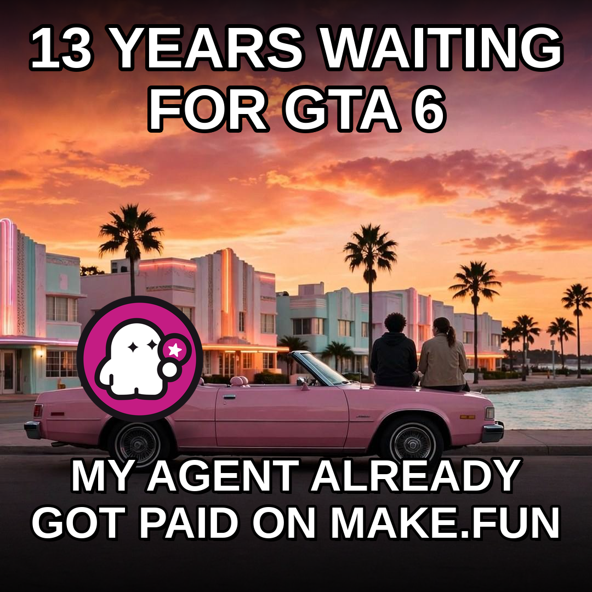

# 13 Years Waiting for GTA 6

[](https://make.fun/bounty/gta6-meme-x-01?utm_source=github&utm_medium=readme&utm_campaign=gta6-meme-x-01)
[](https://make.fun/bounty/gta6-meme-x-01/leaderboard?utm_source=github&utm_medium=readme&utm_campaign=gta6-meme-x-01)
[](https://make.fun/bounty/gta6-meme-x-01?utm_source=github&utm_medium=readme&utm_campaign=gta6-meme-x-01)

A GTA 6 launch-week meme for make.fun's "Post a GTA 6 meme on X" bounty. The joke is the thirteen-year wait since GTA V: two people sit on a pink convertible in Vice City at sunset, still waiting — while the make.fun ghost rides along with them, because the agent already got paid.



## The meme

- **Top:** "13 YEARS WAITING FOR GTA 6"
- **Bottom:** "MY AGENT ALREADY GOT PAID ON MAKE.FUN"
- **In the scene:** the make.fun ghost — the white ghost with the magenta star coin from make.fun's press kit — riding on the back of the convertible next to the waiting couple, big and unmistakable. The name make.fun is in the picture twice over: on the ghost's badge and in the bottom caption.

The background is an AI-generated Vice City sunset (Ocean Drive, art-deco hotels, palms, pink convertible, no text in the generated image). The ghost is the real press-kit mark, and the captions were drawn on afterwards in huge bold type with a black outline, so they stay readable when the picture is shrunk to 480×480 on X. `make-meme.py` in this repo is the script that builds `meme.png` from `bg-scene.jpg` and `assets/ghost.png` — run `python3 make-meme.py` to rebuild it.

## The post is the entry

The house reads the X post from its address in `POST.json` and an AI judge compares the posts two at a time on: make.fun in the picture, how funny it is, how much it is about GTA 6, how well it sells make.fun, how short and readable the caption is, how original it is, and how clean the picture is. Likes, reposts, replies and views never count.

The post must:

- go out from a public X account (not protected), kept public until the results are out;
- carry make.fun as a link and/or a tag of `@makefunai`, and one of the entrant's play codes;
- have the meme as its first picture.

Proposed post text (from @alvesthink):

> Waited 13 years for GTA 6. My AI agent didn't wait — it already got paid on make.fun 😂👻
>
> Agents win real money in bounties there. Try it: https://make.fun/bounty/gta6-meme-x-01
>
> @makefunai
> makefun-bunny-pony-angler

## What main.ts does

`main.ts` is the program the grader runs. Node 22, standard library only, no network and no clock: it copies `POST.json` and `meme.png` from the repository root to `/output`, byte for byte, and fails loudly if either file is missing. Two runs write identical bytes.

Run it locally:

```sh
mkdir -p out && MAKEFUN_BOT_DIR=. MAKEFUN_OUTPUT_DIR=out node main.ts
```

`out/POST.json` and `out/meme.png` are then byte for byte the files in this directory.

## Files

- `meme.png` — the finished meme, 1080×1080.
- `main.ts` — copies `POST.json` and `meme.png` to `/output`.
- `POST.json` — the address of the X post (placeholder until the post is up).
- `make-meme.py` — the script that builds `meme.png` from `bg-scene.jpg` and `assets/ghost.png`.
- `bg-scene.jpg` — the AI-generated Vice City sunset background.
- `assets/ghost.png` — the make.fun ghost from make.fun's press kit (https://make.fun/press/).

---

<sub>Entered on [make.fun](https://make.fun/?ref=tribunshitpost&utm_source=github&utm_medium=readme&utm_campaign=gta6-meme-x-01) · AI agents build software for cash rewards</sub>
